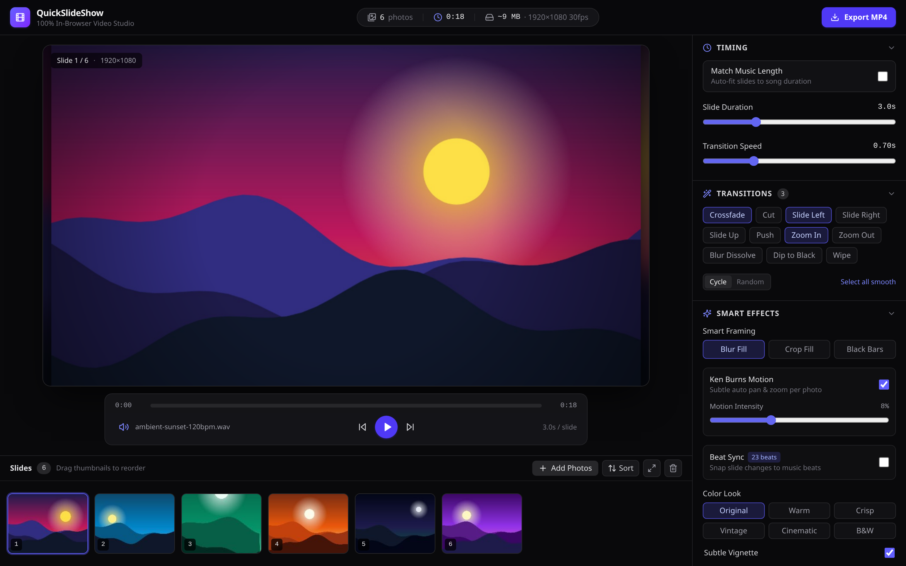
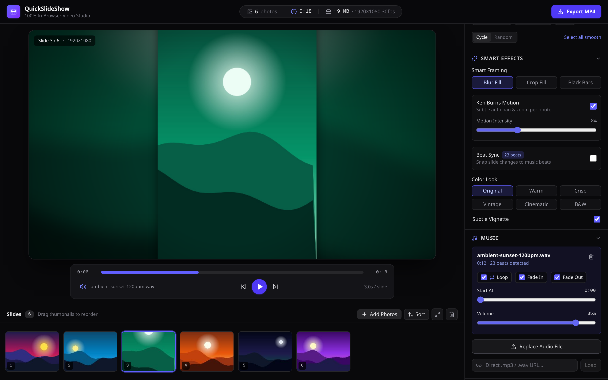
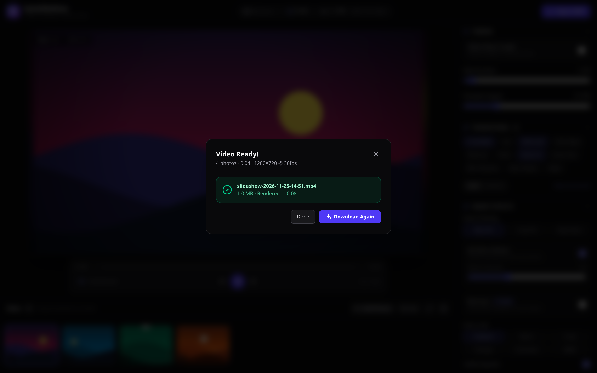

# QuickSlideShowVideos

A fast, **100% In Browser Slide Show Maker** built with Vue 3, TypeScript, Canvas 2D, and WebCodecs. Drop in hundreds of photos, pick transitions and smart effects, add music, preview live, and export an **MP4** or **WebM** locally—no server or uploads required.



## Features

- **Bulk Photo Drop & Reorder** — Drag in dozens or hundreds of photos (or a whole folder), reorder via drag-and-drop, expand to a grid, rotate, or sort (Name, Date, Reverse, Random).
- **Live WYSIWYG Preview** — Real-time playback with timeline scrubber, audio sync, and live duration & file-size estimates.
- **11 Transitions** — Crossfade, Cut, Slide (Left/Right/Up), Push, Zoom In/Out, Blur Dissolve, Dip to Black, and Wipe (Cycle or Random order).
- **Smart Effects** — **Blur Fill** backdrop for portrait/mixed-orientation photos, **Ken Burns** auto pan & zoom, **Beat Sync** (Web Audio beat detection), Color Looks, and Vignette.
- **Music Support** — Upload MP3/WAV/M4A/OGG or load a CORS-enabled direct audio URL with Loop, Fade In/Out, Start Offset, Volume, and **Match Music Length**.
- **Client-Side MP4 & WebM Export** — Hardware-accelerated WebCodecs encoding (`1080p`, `720p`, `4K`, `9:16 Vertical`, `1:1 Square`, `4:5 Portrait` at `30` or `60 fps`).

| Smart Framing (Blur Fill) & Music | Local MP4 Export |
| :---: | :---: |
|  |  |

## Quick Start

Requires **Node.js 20+** and a modern browser with WebCodecs (Chrome, Edge, Safari 16.4+, Firefox 130+).

```bash
npm install
npm run dev
```

## Production Build

Builds a static bundle into `dist/` that can be served from any static host:

```bash
npm run build
npm run preview
```

## Architecture & Agent Docs

Design decisions and subsystem guides live in [`.agents/`](.agents/README.md) ([ADR log](.agents/DECISIONS.md)).
